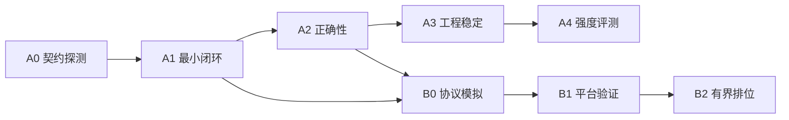

# 开发计划

> 状态：计划，未开始实现。
> 创建时间：2026-11-02。
> 唯一依据：[接入方案](riichi-dev-integration.md)（审查修订版）及其引用的 [可行性审查](feasibility-review.md)。本计划不引入方案之外的范围；方案变更时本计划必须同步修订，冲突处以方案为准。
> 每项任务标注方案章节出处（如 §4.2）；退出条件未注明出处的，均来自方案 §10 阶段表。

## 0. 总览

### 0.1 里程碑与依赖

| 里程碑 | 交付 | 退出条件（§10） |
|---|---|---|
| A0 | 依赖锁、黄金夹具、契约探测记录、仓库脚手架 | 锁依赖；固化事件/完整 state/立直/序列化及规则夹具；关闭接口未知项 |
| A1 | tracker + decision + mapping + HTTP 后端 + agent + 单局 runner | 单局 turn/response 跑通，无隐藏信息泄漏 |
| A2 | 三条验收路径（parity / HTTP 契约 / 引擎一致性）+ 覆盖矩阵 | 无未解释状态/特征差异；所有动作及关键窗口覆盖 |
| A3 | 批量 selfplay + artifacts + 故障处理 | 固定种子 ≥100 半庄，零非法动作/断言/fallback；同环境重跑一致 |
| A4 | evaluation 统计与实验协议 | 固定基线、配对轮换、统计区间，报告提升/回退/证据不足 |
| B0 | online client/session + 模拟服务器测试 | 请求、ack、超时、迟到、断线；每请求最多一次回复 |
| B1 | 真实 /ws/validate 接入 | 真实 validation_result；审查 defaulted/fallback 和延迟 |
| B2 | 有界排位 | 预定批次与停止阈值，故障不继续开启新局 |

投入顺序：先 A0–A2，再并行 A3/A4 与 B0；正式上线（B1/B2）依赖本地验收完成（§10 末段）。

### 0.2 明确延期项（不进入本计划，§1）

- 库模式推理后端（in-process predictor）。
- 批量 GPU 调度。
- 复杂诊断工具。

## 1. A0 契约探测

### 任务

| # | 任务 | 内容 | 出处 |
|---|---|---|---|
| A0-1 | 仓库脚手架 | `pyproject.toml`（生产依赖精确锁定：riichienv、httpx、websockets、PyYAML；不写本机 `file:///` 路径）；`rilab/` 包骨架与空模块（§10 模块清单）；`cli.py` 注册 `probe / parity-check / arena-selfplay / arena-online`；`configs/` 三份配置（selfplay/online/parity）骨架；`outputs/` 不入 git | §10 |
| A0-2 | 环境与依赖锁 | 固定 Python 版本与依赖锁文件；验证 websockets 锁定版本的 `additional_headers` 等 API 可用；记录引擎版本（实测基线 riichienv==0.4.11）与规则（`GameRule.default_tenhou()`）；发行包与主分支不视为相同，验收以锁定包为准 | §10、§2 |
| A0-3 | 黄金夹具采集 | 一次性脚本驱动 RiichiEnv 定向/种子对局，固化夹具集：每席 `new_events()` 事件增量、跨局与终局、立直前后（tsumo→reach→dahai→reach_accepted）、吃碰后弃牌、同种牌摸切/手切、杠/岭上/抢杠/宝牌、多家和牌；含 Observation base64 序列化往返；不用随机运行代替罕见边界覆盖；存 `tests/fixtures/` | §2 |
| A0-4 | 真实 API 最小请求 | 对外部 train_mj `serve-api` 完成 turn/response 各一条黄金请求；记录 `/v1/models` 基线：任务、支持 schema、维度、candidate_limit、校准；`hidden_size` 不作为兼容性条件 | §2、§3 |
| A0-5 | 契约登记 | 建立四类兼容性记录：HTTP 结构、feature_schema 语义、模型权重与校准、引擎版本与规则；登记已知训练缺陷（红五加杠目标差异）为独立失败项 | §3、§4.3 |
| A0-6 | parity 环境约定 | `TRAIN_MJ_ROOT` 指向固定 tag（train_mj 每次参数量调整都会打新 tag，tag 即版本边界；审查基线 `1e5092f…` 为 full_state_v2，截至审查尚未打 tag，需先补打 tag 才能锁定）（只读，默认 CI 不依赖开发者磁盘）；开发可编辑安装另行检查所处 tag 与 dirty；权重 SHA256 由部署清单提供，不由 checkpoint 路径代替 | §2、§9、§6 |

### 退出检查

- 夹具全部入库并可被测试加载；序列化往返一致。
- 接口未知项全部关闭或转为登记的待验证项（对应 §2 表第 3 列）。
- train_mj 已为 full_state_v2 基线打 tag，`TRAIN_MJ_ROOT` 锁定到该 tag；此后所有锁定、记录与升级判断以 tag 为准。
- `rilab probe` 可对真实服务输出契约基线报告。

## 2. A1 最小闭环

### 任务

| # | 任务 | 内容 | 出处 |
|---|---|---|---|
| A1-1 | 状态跟踪器 | `tracker/state_tracker.py`：每局每席独立；只消费 `obs.new_events()` 逐项 `json.loads`；在线散发 MJAI 仅记传输日志不重复喂入；不做 JSON 哈希去重、不加第二套游标；只维护自家精确手牌与公开信息，`?` 不转牌种；内部断言失败立即报错 | §4.1 |
| A1-2 | 事件语义实现 | `start_kyoku` 重置局内状态；任意玩家 tsumo 减 `remaining_tiles`、仅自家加手牌与 `turn_number`；`reach`→reach1+pending、其后宣言弃牌标记；`reach_accepted`→reach2、立直巡目、扣 1000 点并加供托，权威覆盖与增量更新不得双扣；chi/pon/daiminkan 自家扣 consumed、对手仅公开副露；ankan/kakan 保存宣杠前快照与提案，窗口结束后再提交副露升级；dora 更新指标与公开事件；hora/ryukyoku/end_kyoku/end_game 完整生命周期，多家荣和不丢结果 | §4.3 |
| A1-3 | state 快照 | 按 §4.2 契约表输出完整 state：绝对座位与 `seat_wind=(actor-dealer)%4`；kyoku 1..4 转 0 起算；`5mr/5pr/5sr→0m/0p/0s`、`E/S/W/N/P/F/C→1z..7z`；`remaining_tiles` 训练口径；`turn_number`=自家摸牌次数；整数点数即时更新；牌河保留被鸣走弃牌；`own_melds=all_melds[actor]`；riichi 自家与四家字段一致、区分 pending/已接受；振听标志；`last_discard_*` 可为 null 且吃碰大明杠后按训练语义清理；`response_target` 区分弃牌/抢杠窗口 | §4.2 |
| A1-4 | 决策上下文与候选绑定 | `decision.py`：DecisionContext（turn/response 由动作阶段决定，不看最后事件是否 tsumo）；CandidateBinding（原始合法 Action、精确牌、consumed 组合、后续计划）；selected_action 唯一回查（不只按 kind 匹配；response 不把 raw top-1 当 calibrated 结果）；超 candidate_limit 明确失败不截断；同牌普通物理副本按训练语义合并并确定性选代表，赤牌/不同吃法/consumed 组合不合并 | §5 |
| A1-5 | 动作映射 | `mapping/action_mapping.py`：按 §5 映射表（Discard/Riichi 两阶段/Tsumo/Ankan/Kakan/KyushuKyuhai/Chi/Pon/Daiminkan/Ron/Chankan/Pass）；`select_action_from_mjai` 仅作附加校验不作语义兜底；立直辅助（`check_riichi_candidates` 返回 136 牌 ID）与合法 Discard、红牌、副露约束交叉验证 | §5 |
| A1-6 | 两阶段立直状态机 | PendingRiichiPlan：reach1 前评分 → 仅在引擎提供 Riichi 时缓存计划并只执行 Riichi → 下次弃牌决策确认计划与新合法集合后执行 X（不在已宣言快照重评）→ 拒绝/默认/终局/状态不符清除计划；本地评测失败退出，在线按权威候选处理 | §5 |
| A1-7 | HTTP 后端 | `backends/http_backend.py`：httpx 连接复用与启动预热；启动读 `/v1/models` 做兼容性检查（§3 清单）；`pass_bias` 默认 null 用服务端配置、显式 0 保留；`no_yaku_call_penalty` 知悉为服务端配置非请求参数 | §3、§6 |
| A1-8 | Agent 与单局 runner | `agent.py` 串联 tracker/binding/backend；单局 runner 跑通完整局并落盘雏形决策日志；确认 runner 的全知手牌、牌山与未来事件不进入模型请求 | §3、§4.1 |

### 退出检查

- 单局（含至少一次立直与一次鸣牌）turn/response 全部经真实 API 跑通。
- 隐藏信息泄漏检查：请求体仅含 §4.2 契约字段。
- tracker 断言零静默降级路径。

## 3. A2 正确性

### 任务

| # | 任务 | 内容 | 出处 |
|---|---|---|---|
| A2-1 | XML→MJAI 转换器 | `scripts/` 转换器本身纳入测试：事件顺序、红牌、掩码、结局；预测不得读取未来 | §9 |
| A2-2 | 路径 1：状态/特征 parity | 固定 Tenhou 夹具双路径（train_mj sample_builder vs 转换器+tracker）；按局/席位/事件/窗口匹配决策；先比快照，再在开发进程用固定版本验证器与编码器比较 state 和 candidate 特征；整数/布尔/布局精确一致，浮点明确 dtype 与容差；两套规则候选不承诺相等，仅比相同语义候选并报告覆盖差异 | §9 |
| A2-3 | 路径 2：HTTP 契约测试 | 黄金请求经真实路由/服务：元信息、嵌套必需字段、错误码、候选上限、校准 null/显式 0、结果回查；临时小权重用于 CI，真实权重单独联调 | §9 |
| A2-4 | 路径 3：引擎一致性 | 定向夹具与批量对局独立验证自家手牌、公开状态、分数与动作执行，不只比较训练规则与自身 | §9 |
| A2-5 | 覆盖矩阵 | §9 覆盖清单全部用例化（见 §6 测试矩阵）；红五加杠目标差异单列失败、阻断未解释上线 | §9、§4.3 |
| A2-6 | CI 分层 | 默认 CI：黄金夹具、映射、模拟 session；parity（固定训练依赖）为必需集成检查；真实权重/长批量/平台验证为发布前验收；skipped 不作 passed | §9 |

### 退出检查

- 三条路径全绿；差异清单每一项要么修复、要么有登记的解释（已知缺陷除外）。
- 覆盖矩阵中"重复请求、迟到、默认动作、断线"允许在 B0 后补全，其余 A2 内完成。

## 4. A3 工程稳定

### 任务

| # | 任务 | 内容 | 出处 |
|---|---|---|---|
| A3-1 | 批量 selfplay | `selfplay.py`：固定种子列表、席位轮换、A+3B / B+3B 对照编排；相同 seed 不保证分叉后同牌山，保存引擎、规则与可用牌山标识并明确配对边界 | §7 |
| A3-2 | 产物与运行清单 | `artifacts.py`：`outputs/arena/<run_id>/` 下 manifest.json（本仓库 commit 与 dirty、训练仓库 tag 与 dirty、依赖/Python/引擎、完整规则、权重哈希、校准、种子、席位安排、统计协议）、games/*.mjai.jsonl、decisions/*.jsonl（决策编号、事件范围、快照、候选绑定、模型选择与实际动作、raw/calibrated、耗时、错误与 fallback）、summary.json | §7 |
| A3-3 | 故障与失效语义 | 状态断言/非法动作/推理失败：保存错误局与已完成产物，运行标记无效并非零退出，不过滤失败局给强度结论；写盘故障使评测失败；评测期间模型元信息变化使运行失效（禁热更） | §6 |
| A3-4 | 日志治理 | 有界日志队列与容量限制；首轮保留完整输入，后续压缩分片 + 可回放事件 + 抽样完整快照，错误局完整保留 | §7 |
| A3-5 | 重跑一致性 | 同环境同种子重跑，验证产物与结果一致 | §10 |

### 退出检查

- 固定种子 ≥100 半庄：零非法动作、零断言失败、零 fallback；重跑一致。
- 明确记录：此阶段结果只作工程冒烟，不作强度证据（§7）。

## 5. A4 强度评测 与 B 系列在线

### A4

| # | 任务 | 内容 | 出处 |
|---|---|---|---|
| A4-1 | 统计实现 | `evaluation.py`：主指标平均顺位差（低为好）与末位率；辅助终局点数、和率、放铳率、立直率、副露率；逐项明确分母与双响等计数口径；振听率仅诊断；并列顺位按锁定引擎规则 | §7 |
| A4-2 | 实验协议 | 预注册最小有意义收益、样本量/预算、停止规则；按"种子及其全部席位轮换"为统计簇，配对差 + 95% cluster bootstrap 区间（同桌四席不作独立样本）；校准种子与最终验收种子分离；未达标准或区间跨零 → 证据不足 | §7 |
| A4-3 | 席位设计 | A+3B 与 B+3B 为主；2A+2B 六种席位组合补充；同桌两个 A 不作队友 | §7 |

### B0 协议模拟

| # | 任务 | 内容 | 出处 |
|---|---|---|---|
| B0-1 | session 生命周期 | `online/session.py`：Connecting→Playing→Finishing→Closed；断线进 Disconnected；原局不重连恢复，只记录未完成并在允许时开新局；验证模式 end_game 后有界等待 validation_result 或结束信号 | §8 |
| B0-2 | 消息循环 | 接收任务持续读取；单一任务按序修改 tracker；推理用不可变快照；重复 request_id 不重放观察；已结束/超时请求的迟到推理不再发送；以 action_ack 确认 accepted/rejected/unparseable/stale/defaulted，禁止把模型意图当执行结果 | §8 |
| B0-3 | 时间预算 | 逐请求读取 deadline/grace/bank（不固定 18s）；单调时钟记录接收时点，扣除入站时间与发送余量；正常推理目标在 grace 内；异步可取消 HTTP，接收循环不被同步请求阻塞 | §8、§6 |
| B0-4 | 备用动作 | 预算内从当前合法集合确定性备用（合法和牌、pass、合法摸切；吃碰后无摸牌时合法弃牌）；备用仅保证合法不宣称防守安全；记录 fallback 与实际执行；无法证明合法时不猜动作，交服务器默认并记录会话故障 | §6 |
| B0-5 | 兼容交叉验证 | 本地 legal_actions 与线上 possible_actions 按精确牌、consumed 语义交叉验证（非 JSON 全等）；冲突记兼容性故障不造动作；未知消息记录并忽略；影响状态且无法理解 → 停止决策标记会话异常 | §8 |
| B0-6 | 密钥管理 | 平台 token 与 HTTP key 独立环境变量；日志脱敏 | §8 |
| B0-7 | 模拟服务器测试 | 覆盖请求、ack、超时、迟到、重复 request_id、断线；每请求最多一条回复（禁止同次 reach+dahai） | §10 |

### B1 / B2

| # | 任务 | 内容 | 出处 |
|---|---|---|---|
| B1-1 | 平台验证 | 真实 `/ws/validate` 全流程通过，取得真实 validation_result；审查 defaulted/fallback 记录与延迟分布；平台通过≠棋力或低延迟证明 | §8、§10 |
| B2-1 | 有界排位 | `/ws/ranked` 预定批次与停止阈值；故障不继续开新局；完整决策与事件日志落盘 | §10 |

## 6. 测试矩阵（覆盖清单 → 用例，§9）

| 用例组 | 覆盖点 | 里程碑 |
|---|---|---|
| turn 动作全覆盖 | 六类 turn 候选各至少一例 | A2 |
| response 动作全覆盖 | 七类 response 候选各至少一例（含 pass/ron/chankan） | A2 |
| 红牌与物理副本 | 5mr↔0m、同牌副本合并、赤牌不合并 | A2 |
| 吃碰后弃牌 | 仍属 turn 决策、turn_number 不增 | A2 |
| 立直两阶段 | reach/reach_accepted、宣言牌、宣言牌被荣和不提前计接受 | A2 |
| 放弃和牌与振听 | 决策反馈提交、振听建立与清除、hora 不在候选不反推振听 | A2 |
| 杠与宝牌 | ankan/kakan/岭上/抢杠窗口前快照/dora 顺序对拍 | A2 |
| 多家和牌、跨局终局 | 双响结果保留、end_kyoku/end_game 生命周期 | A2 |
| 引擎一致性 | 手牌/公开状态/分数/动作执行独立验证 | A2 |
| HTTP 契约 | 元信息/必需字段/错误码/上限/校准 null 与显式 0/回查 | A2 |
| 重复请求、迟到、默认动作、断线 | 模拟 session 全路径 | B0 |
| 序列化兼容 | 在线 request_action 与本地 Observation 序列化一致（真实服务器） | B1 |

## 7. 计划维护规则

- 方案文档是唯一范围来源；本计划任何任务与方案冲突时，先改方案再改计划。
- 每个里程碑合入前：对应退出检查逐项打勾，`skipped` 不视为 `passed`（§9）。
- A0 产出的契约基线（夹具、/v1/models 快照、依赖锁）是后续所有阶段的验收参照；引擎或服务端任何升级都必须重新执行 A0-3/A0-4 并重跑 A2；train_mj 发布新 tag（参数量调整）时同样重跑 A0-4 契约探测与 A2，再决定是否采纳新 tag。
