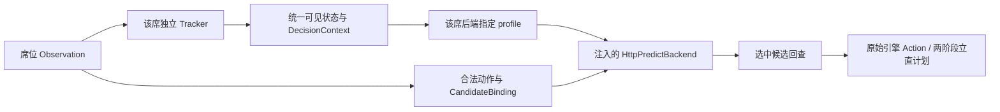

# 多版本后端与适配契约（配置版本 1）

2026-11-02 补充。对应 [接入方案](riichi-dev-integration.md) §3、§7，配置示例为 [arena_selfplay.yaml](../configs/arena_selfplay.yaml)。本轮实现配置校验，不提前实现 A1 适配器、A3 调度或 A4 统计。

## 1. 两个版本不是同一输入契约

以下事实来自 train_mj 本地 tag 的代码与当前权重文件，不通过浮动分支名推定：

| 项目 | v1.2.0 基线 | v1.3.0 候选 |
|---|---|---|
| 固定 commit | 758981ab9fb457c882ab9c577c9377976f97f42b | 1e5092f344fb69bcdf4697f683f2ecf15b9865d8 |
| 分支说明 | 用户所称 master 基线；本地实际存在 main、v1.2，无 master | 本地实际名 codex/full-state-features |
| 配置 backend_id | v1_2_0 | v1_3_0 |
| adapter_profile | legacy_v1_2 | full_state_v2 |
| state 维度 turn/response | 8173 / 8216 | 11969 / 12012 |
| action 维度 turn/response | 89 / 91 | 89 / 91 |
| 模型元信息 feature_schema | 不返回该字段 | full_state_v2 |
| remaining_draws_estimate | 训练采样为 max(0,18-自家摸牌次数)；服务校验会 int 规范化 | 从 remaining_tiles/4 派生 |
| discard_history | actor/tile，旧接口规范化会丢弃新标志 | actor/tile/tsumogiri/riichi_discard |
| 全局上下文 | 旧布局，不得宣称 full_state_v2 | 完整 state 必需字段及公开事件/副露布局 |
| 对应 tag 的 api_local 校准 | pass_bias=2.0，no_yaku_call_penalty=0.8 | pass_bias=1.5，no_yaku_call_penalty=0 |

main 当前 HEAD 不是 v1.2.0 的 commit，不能把 main/master 字符串当作可复现版本。branch_hint 只帮助识别来源，实际运行以 tag+commit+两份权重 SHA256 为身份。配置中的权重哈希已从本机两版本 checkpoint 计算；新部署必须验证其实际文件一致。tag 固定代码，不能代替权重哈希。

## 2. 配置字段与约束

一个 backend 表示“运行中的模型服务实例”，一个实例提供 turn/response 两个任务，不代表一个席位。mode=http 是传输方式，不限制实例数量。

- config_version=1。旧单例 backend 与 matcher.candidates/baseline 结构不再适用于自对弈；加载时拒绝旧结构，不能静默回退到同一服务。
- backends 为 backend_id→定义的字典。每项包括 mode、独立 api_base、adapter_profile、revision.tag/commit/branch_hint、timeout_seconds、response.pass_bias、model_identity.turn_sha256/response_sha256。
- 每个实例独立 HTTP 客户端/兼容性登记与校准；相同 backend_id 可供多个席位复用无状态连接池。两个不同版本不得指向同一未分路的 URL 或靠对局中热更权重切换。
- pass_bias=null 表示使用该实例服务端默认值；显式 0 表示覆盖，不能按真假值替换。最终使用的 pass_bias、no_yaku_call_penalty 按实例落 manifest，不能用一份全局校准覆盖两个版本。
- profile 决定状态投影及兼容性规则，backend_id 只用于引用。同 profile 可有多个权重实例；不同 profile 必须分别通过 parity。
- model_identity 为部署预期哈希；现有 /v1/models 不提供远端文件哈希，A1 不能声称 HTTP 能独立证明它。需部署清单验证，A3 封存到运行清单。
- A0 的 load_arena_config 校验已登记 profile/版本、后端引用、端点、哈希形式、校准和席位形状。seeds 为空可作当前设计模板；A3 启动必须拒绝空 seeds、缺失统计协议或不完整配对组。

profiles 在 rilab/config.py 登记。legacy_v1_2 缺少 feature_schema 并不代表任意旧服务都兼容：A1 必须核对指定版本身份、8173/8216 和 89/91、任务及 candidate_limit；full_state_v2 还要验证显式 schema。不能按维度自动选择一个未知 profile。

## 3. 席位编排语义（A3）

matchups 的 seats 按绝对席位 0..3 引用后端；每项有唯一 id、focal_seat、rotation、paired_group。

- candidate_vs_baseline：初始 [v1_3_0,v1_2_0,v1_2_0,v1_2_0]，focal_seat=0，cyclic4。
- baseline_control：初始四席均为 v1_2_0，focal_seat=0，cyclic4；即使四个 ID 相同，也必须保留四个不同的焦点席位实验记录，不能去重成一局。
- two_vs_two：初始 [v1_3_0,v1_3_0,v1_2_0,v1_2_0]，unique6，focal_seat=null；枚举候选占据的六种二席组合，无团队奖励。

cyclic4 的第 r 次轮换：原席位 s 的后端和焦点身份一起移动至 (s+r)%4。配对键为 (paired_group,seed,r)；candidate_vs_baseline 和 baseline_control 使用相同键。unique6 与主实验分开报告，不混入主指标。

每个种子在示例配置生成 4 个候选局、4 个基线控制局、6 个 2v2 局，共 14 半庄。seeds 数是实验簇数，不等同半庄数；不再同时配置相互矛盾的 games 总数。A3 生成确定性的预展开日程并保存实际席位映射；任何缺局使配对组无效，不静默筛选。

## 4. 后端注入与适配链（A1）

A1 的构造接口应为 MjaiBotAgent(player_id, backend, adapter)，不读取全局默认 URL。BackendRegistry 按配置创建服务实例，AdapterRegistry 按 profile 创建/选择状态投影器，runner 根据四席映射构造四个 agent。

四席必须各自持有 tracker、PendingRiichiPlan 和决策反馈；可以共享无状态 profile 代码与同实例 HTTP 连接池，不能共享可变局面。统一 tracker 不直接产出某个版本的特征：LegacyV12Adapter 和 FullStateV2Adapter 分别投影为对应 HTTP state，动作仍绑定本次引擎合法集合。旧版不能直接复用 full_state_v2 请求并依赖服务端忽略字段。

A1 先用手工四席绑定完成单局，不实现自动轮换；验收须证明两个 URL 按绑定收到各自座位的请求、profile 正确、状态不串席。A2 分别对两个固定版本的采样器/编码器对拍，不能以新版 parity 代替旧版验收。

## 5. 强度统计（A4）

主实验比较同一配对键的 focal seat：v1.3.0 对三份 v1.2.0，与 v1.2.0 对三份自身。输出平均顺位差、末位率差、指标分子/分母和以 seed 全部轮换为簇的 95% bootstrap 区间。A4 不从 top-k 准确率推导强度。

每个 backend 单独记录服务元信息、两份权重、profile、校准与延迟/错误；运行清单不是一份“全局模型”。本例默认校准各不同，因此首先比较“版本整体部署策略”的效果。如需单独归因权重/特征，另设显式控制校准的实验，不改变主实验解释。

## 6. 部署与阶段边界

训练仓库代码仍只读使用。可为 v1.2.0 与 v1.3.0 分别准备独立 checkout 和服务环境，权重按各自部署清单放置，用两份 api_local 配置启动到端口 8000/8001。不要在一个 Python 进程反复修改 sys.path 来同时 import 两份 mjai；不要为切换版本修改当前训练 checkout。

当前交付是修复后的 A0 证据、配置/校验与本契约。A1 完成注入和两种投影；A3 完成日程与多版本席位编排；A4 完成统计。A1/A3/A4 的占位模块与 CLI 不因此宣称已实现。v1.3.0 已做真实权重 HTTP 路由联调；v1.2.0 本轮核对源码及权重哈希，双服务对战留作 A1–A3 验收。
