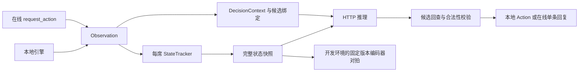

# riichi.dev 接入方案（审查修订版）

> 状态：设计阶段，适配层尚未实现；修订于 2026-11-02。
> 结论：本地对局评测具备工程可行性；线上接入有条件可行。先证明状态与动作适配正确，再投入大量对局和线上排位。
> 原方案问题、审查证据及实测结果见 [可行性审查](feasibility-review.md)。

## 1. 目标、边界与优先级

本仓库是独立四麻适配项目，连接 RiichiEnv 与 train_mj，不修改训练仓库。第一目标是可信、可复现的新旧模型对局比较；第二目标是接入线上验证与排位。和牌、计分及动作合法性由引擎负责，特征计算由推理服务负责。

离线牌谱评估继续保留：它测量拟合能力和错例分布，对局评测测量特定规则与对手下的结果。四个相同模型自对弈用于正确性和稳定性检查，不能单独证明强度提升。

首版实现 HTTP、本地 runner、状态/动作适配、日志及验收。库模式推理、批量 GPU 调度及复杂诊断延期，避免同时维护两套生产后端。

## 2. 可行性依据与待关闭条件

| 依赖 | 已核实 | 仍需验证 |
|---|---|---|
| train_mj | /v1/models；turn/response 预测；完整状态校验；服务端编码 | 适配器状态配合真实权重的端到端正确性、延迟与吞吐 |
| RiichiEnv 0.4.11 | 当前 Windows 可安装运行；两场半庄；序列化往返；立直两阶段与候选辅助函数 | 所有边界动作、跨局事件、完整回归和训练特征一致性 |
| riichi.dev | 观察、合法动作、动态预算、验证及排位端点的公开协议 | 服务器与客户端序列化兼容、目标规则、真实网络表现 |

版本锁定：train_mj 以 tag 固定版本（该仓库每次参数量调整都会打新 tag，tag 即版本边界），不用裸 commit；审查时基线为 commit `1e5092f344fb69bcdf4697f683f2ecf15b9865d8`（full_state_v2，截至审查尚未打 tag，A0 锁定前提是为其补打 tag）。上游源码 commit `0ee1236a283b15508f3ac28407027f340b81e1de`；实测发行包 riichienv==0.4.11。发行包与主分支不自动视为相同，验收以锁定包为准。

同一引擎家族不保证客户端与服务器版本、规则、序列化一致。上游 README 和网站本地循环示例存在差异，以锁定包实测为准。[引擎说明](https://github.com/smly/RiichiEnv)、[平台本地测试说明](https://riichi.dev/docs/local-testing)。

A0 阶段必须固定 Python/依赖锁，保存以下黄金夹具：每席事件增量、跨局与终局、立直前后、吃碰后弃牌、同种牌摸切/手切、杠/抢杠/宝牌；再用真实 API 完成 turn/response 最小请求。不用随机运行代替罕见边界覆盖。

## 3. 架构与契约

运行时仅依赖 HTTP；开发/CI 的 parity 环境允许读取固定 tag 版本的 train_mj 解析器、采样器和编码器，不需要新增生产库模式。

兼容性分开记录：HTTP 结构、feature_schema 语义、模型权重与校准、引擎版本与规则。参数量变化不一定影响适配层；状态或特征语义改变必须重新对拍，不能承诺重启服务即可兼容。

启动读取 /v1/models，检查任务、支持的 schema、维度、candidate_limit 和校准；hidden_size 不应固定为兼容性条件。默认 pass_bias=null 使用服务端配置，显式 0 必须保留。no_yaku_call_penalty 当前由服务端配置，不是现有请求参数。

现有预测 API 返回 selected_action、predictions 和模型信息，不返回编码特征；也没有独立状态 schema 版本号。只比较 OpenAPI 或顶层字段不足以检测嵌套 state 语义漂移。

## 4. 状态适配

### 4.1 单一事件来源、每席隔离

每局每席独立 tracker，只消费 obs.new_events()，逐项 json.loads。在线散发 MJAI 用于传输日志，不能再次喂入同一 tracker；平台迁移指南采用这条输入路径。[官方迁移说明](https://riichi.dev/docs/mortal)。

首个 Observation 可能包含此前公开历史，需要从 start_game/start_kyoku 初始化。不要按 JSON 内容哈希去重：相同内容可以是多次真实事件；不要在 new_events 上再增加第二套游标。重复在线 request_id 在 session 层拦截，不再次应用观察。对 new_events 的重复调用行为由发行包夹具固定，不推测调用会修改游标。

只维护自家精确手牌、公开牌及对手隐藏牌数量；? 不转成牌种。runner 的全知手牌、牌山与未来事件不进入模型请求。

### 4.2 state 契约

完整字段以锁定 tag 版本的 mjai/serving/validation.py::_validate_full_state 为准，语义与 sample_builder 的玩家快照对齐：

| 字段 | 正确口径 |
|---|---|
| feature_schema | 当前 full_state_v2；未知版本拒绝启动 |
| actor/dealer/seat_wind | 绝对座位；seat_wind=(actor-dealer)%4 |
| round_wind/round_number/match_rounds | 风和局号 0..3；MJAI kyoku 通常 1..4，转为 0 起算；赛制 4/8 或确实未知的 null |
| hand | 精确牌→数量字典；5mr/5pr/5sr→0m/0p/0s，E/S/W/N/P/F/C→1z..7z |
| remaining_tiles | 训练口径初始 70；每次普通/岭上摸牌减一，宣杠不重复扣 |
| turn_number | 自家实际摸牌次数；吃碰后弃牌不增加 |
| scores/honba/riichi_sticks | 实际整数点数；立直接受时即时更新，不能等下一局覆盖 |
| all_discards/discard_history | 保留被鸣走弃牌；历史含 actor/tile/tsumogiri/riichi_discard |
| all_melds/own_melds | 四家列表，own_melds=all_melds[actor]；保存 kind/source/called_tile/consumed_tiles |
| riichi_declared/riichi_declared_by_player/riichi_turn_by_player | 自家与四家字段一致；区分 pending 与已接受 |
| public_events/dora_indicators | reach1/reach2/chi/pon/daiminkan/ankan/kakan/dora；记录发生时 discard_count |
| temporary_furiten/riichi_furiten | 自家标志，需要观察与已确认的决策结果支持 |
| last_discard_actor/last_discard_tile | 可为 null；吃碰大明杠后按训练快照语义清理 |
| response_target | response 必需，source 与精确 tile，区分弃牌及抢杠窗口 |

remaining_draws_estimate 是服务端派生量 remaining_tiles/4，不是从 70 开始递减的请求字段。座位旋转在服务端完成。

### 4.3 事件与决策时点

- start_kyoku 重置局内状态；任意玩家 tsumo 均减少 remaining_tiles，只有自家增加精确手牌和 turn_number。
- reach 映射 reach1 并设置 pending；其后 dahai 标记宣言牌。reach_accepted 映射 reach2，设置训练口径的立直巡目、扣除 1000 点并增加供托。权威分数覆盖与增量更新不得双扣。宣言牌被荣和时不能提前计成立直接受。
- chi/pon/daiminkan 只从自家精确手牌扣 consumed，对手仅更新公开副露；吃碰后弃牌仍属 turn。
- ankan/kakan 保存宣杠前状态与提案。抢杠 response 使用窗口前快照；窗口解决后再提交副露升级。实际加杠牌和原碰叫牌分别保存，加杠沿用原碰来源。
- dora 更新指标与公开事件，并对拍杠与宝牌顺序。hora/ryukyoku/end_kyoku/end_game 完整处理生命周期，多家荣和不得在第一条 hora 后丢失结果。
- turn/response 由 DecisionContext 与动作阶段决定，不能只看最后事件是不是 tsumo。

引擎负责真实合法荣和；tracker 复现训练的振听输入。放弃合法荣和是自家决策事实，不是纯公开 MJAI 事实，需在动作确认或后续引擎事件确认后提交。超时、拒绝和服务器默认时不能记录未执行的模型意图。hora 不在候选里不能反推唯一振听原因。生产环境不再 import 第二套规则引擎推导合法动作。

训练侧已知边界：实际加杠牌与原碰叫牌红五属性不同时，抢杠目标特征有差异。始终用实际加杠牌构造合法候选与 response_target；单列差异，阻断未经解释的上线。需要上游修复/重建或经过验证的兼容决策，不能通过伪造牌来追求逐位相等。

## 5. 动作绑定与两阶段立直

每个预测候选关联 CandidateBinding：原始合法 Action、精确牌、consumed 组合及后续计划。普通动作直接返回绑定引擎对象。同牌普通物理副本可按训练语义合并并确定性选代表，记录摸切/手切策略；赤牌、不同吃法和 consumed 组合不能合并。

模型 selected_action 必须能唯一回查本次候选；不能只按 kind 匹配，也不能把 response raw top-1 当 calibrated 结果。超过 candidate_limit 明确失败，不截断候选。

select_action_from_mjai 可用于附加校验，但可能返回 None，也会宽松匹配缺字段输入；实测缺 pai 的 dahai 仍返回合法弃牌。因此“返回非空”不足以证明语义正确。[固定版本匹配源码](https://github.com/smly/RiichiEnv/blob/0ee1236a283b15508f3ac28407027f340b81e1de/riichienv-core/src/observation/mjai_select.rs)。

| 引擎动作/窗口 | 模型候选 |
|---|---|
| Discard | discard {tile} |
| Riichi + 合法立直弃牌集合 | 每张牌一个 riichi_discard {tile}，绑定两阶段计划 |
| Tsumo | tsumo |
| Ankan/Kakan | ankan/kakan，tile 与精确组成用契约夹具固定 |
| KyushuKyuhai | kyuushu_kyuuhai |
| Chi/Pon/Daiminkan | chi/pon/daiminkan {tile, consumed_tiles, source} |
| Ron，普通弃牌/抢杠窗口 | ron/chankan，由上下文区分 |
| Pass | pass |

立直协议状态机：

1. reach1 前评分。仅在引擎提供 Riichi 时，用 check_riichi_candidates(obs.hand) 等引擎能力获得可弃牌；发行包实测返回 136 牌 ID。必须与合法 Discard、红牌及副露约束交叉验证，不能把全部弃牌当成立直候选。
2. 选中 riichi_discard X，缓存 PendingRiichiPlan（局标识、座位、精确弃牌、预期后续状态）。当前只执行 Riichi/发送 reach。
3. 下次弃牌决策先确认计划与新合法集合，再执行 X，不在已宣言快照重新调用模型改变选择。
4. 拒绝、默认、终局、状态不符则清除计划。评测失败退出；在线依据当前权威候选处理。

每个 request_id 只回复一条动作，禁止同次主动发送 reach+dahai。[官方协议](https://riichi.dev/docs/protocol)。在线序列化需补齐 actor/target/consumed 等必需字段；只有证明摸牌来源时才写 tsumogiri，不能确定时按协议允许省略。

## 6. HTTP 与故障处理

复用 httpx 连接，启动预热；在线用可取消的异步请求，WebSocket 接收循环不能被同步 HTTP 阻塞。总超时覆盖排队、编码、连接、推理和发送。

运行清单保存本仓库 commit 与 dirty 状态、训练仓库 tag（含其指向的 commit）与 dirty 状态、模型 SHA256、特征 schema、校准和依赖锁。API 的 checkpoint 路径不能代替权重哈希；由部署清单提供哈希。评测期间禁止热更，发现模型元信息变化使运行失效。

本地任何状态断言、非法动作或推理失败：保存错误局及已完成产物，运行标记无效并非零退出，不过滤失败局后给强度结论。

在线失败：预算内从当前合法集合选确定性备用动作，例如合法和牌、pass、合法摸切；吃碰后无摸牌时需合法弃牌备用。备用仅保证合法，不宣称防守安全。记录 fallback 与实际执行；无法证明合法回复时不猜动作，交由服务器默认并记录会话故障。

## 7. 可信评测

第一层相同模型与简单代理测试正确性；第二层固定基线比较候选模型：A+3B 与 B+3B，固定种子并轮换候选席位。2A+2B 作补充，采用六种席位组合；同桌两个 A 不作为队友。

相同 seed 有助复现，但行为分叉可能改变随机消耗，不保证后续完全同牌山；保存引擎、规则及可用的牌山标识，明确配对边界。

主指标为平均顺位差（低为好）及末位率；辅以终局点数、和率、放铳率、立直率和副露率。明确每项分母与双响等计数口径，振听率只用于诊断。并列顺位按锁定引擎规则统计。

按种子及其全部席位轮换作为统计簇，报告配对差与 95% cluster bootstrap 区间，同桌四席不能当四个独立样本。100 半庄只作为工程冒烟；强度实验预先规定最小有意义收益、样本量/预算和停止规则。未达到标准或区间跨零，结论为证据不足。校准种子与最终验收种子分离。

outputs/arena/<run_id>/ 保存：

- manifest.json：本仓库 commit、训练仓库 tag、dirty、依赖/Python/引擎、完整规则、权重哈希、校准、种子、席位安排和统计协议。
- games/*.mjai.jsonl：全局引擎回放；与每席模型输入日志隔离。
- decisions/*.jsonl：决策编号、事件范围、快照、候选绑定、模型选择与实际动作、raw/calibrated、耗时、错误与 fallback。
- summary.json：计划/完成/失败数量、指标分子分母、区间与运行有效性。

首轮验收保留完整输入；大批量采用压缩分片、可回放事件和抽样完整快照，错误局完整保留。有界日志队列与容量限制；写盘故障使评测失败，在线慢磁盘不阻塞回复。

## 8. 在线 session

验证 /ws/validate；排位 /ws/ranked；token 通过环境变量，HTTP 密钥独立配置并脱敏。平台验证通过只说明基本协议可用，不说明棋力或低延迟。[官方验证流程](https://riichi.dev/docs/validation)。

生命周期 Connecting→Playing→Finishing→Closed，断线进入 Disconnected。原局不支持重连恢复，只能记录未完成并在允许时开启新会话。验证模式在 end_game 后继续有界等待 validation_result 或明确结束信号。

接收任务持续读取消息，单一任务按序修改 tracker，推理使用不可变快照。重复 request_id 不重放观察；已结束/超时请求的迟到推理不能再次发送。以 action_ack 和后续权威事件确认 accepted/rejected/unparseable/stale/defaulted，禁止提前把模型意图当作执行结果。

逐请求读取 time.deadline_ms/grace_ms/bank_ms，不固定为 18 秒。以单调时钟记录接收时点，减去网络估计与发送余量；服务端从发送起计时，接收后才计时不能涵盖已经消耗的入站时间。正常推理目标在 grace 内，具体预算需端到端实测。

本地 legal_actions 与线上 possible_actions 按精确牌、consumed 等语义交叉验证，不能 JSON 全等比较省略字段。冲突记录兼容性故障，不造动作。未知信息消息记录并忽略；影响状态而无法理解的内容停止模型决策，标记会话异常。

## 9. 正确性闸门

三条验收路径：

1. 状态/特征 parity：固定 Tenhou 夹具经训练 sample_builder 与 XML→MJAI→tracker 两条路径；按局/席位/事件/窗口匹配决策，先比快照，再经固定版本验证器与编码器比较 state 和 candidate 特征。编码器在开发进程执行，不要求 HTTP 返回不存在的向量。
2. HTTP 契约：黄金请求经真实路由/服务验证元信息、嵌套必需字段、错误码、候选上限、校准 null/显式 0 和结果回查。临时小权重可用于 CI，真实权重单独联调。
3. 引擎一致性：定向夹具和批量对局独立验证自家手牌、公开状态、分数与动作执行，不只比较训练规则与自身。

XML 转换器也是受测代码，验证顺序、红牌、掩码及结局，预测不得读取未来。固定黄金 MJAI/快照存入本仓库；TRAIN_MJ_ROOT 配置外部路径，默认 CI 不依赖开发者磁盘。

整数/布尔/布局精确一致，浮点明确 dtype 与容差；确定编码可要求逐位一致。两套规则的候选不承诺完全相等，只对相同语义候选比较编码，并报告覆盖差异。实际推理始终采用引擎候选。已知训练缺陷单独失败，不用宽泛忽略列表掩盖。

覆盖六类 turn、七类 response，红牌、物理副本、吃碰后弃牌、立直两阶段/宣言牌被荣和、放弃和牌与振听清除、杠/岭上/抢杠/宝牌、多家和牌、跨局终局，以及重复请求、迟到、默认动作、断线。

默认 CI 跑黄金夹具、映射与模拟 session；固定训练依赖的 parity 是必需集成检查。真实权重、长批量和平台验证作发布前验收；skipped 不作 passed。

## 10. 目录、依赖与阶段

规划模块：tracker/state_tracker.py、mapping/action_mapping.py、decision.py（DecisionContext/CandidateBinding/PendingRiichiPlan）、backends/http_backend.py、agent.py、selfplay.py、evaluation.py、artifacts.py、online/client.py、online/session.py 和 cli.py。配置区分 selfplay/online/parity；tests/fixtures 保存黄金数据，outputs 不入 git。

生产依赖精确锁定经验证的 RiichiEnv、httpx、websockets、PyYAML；验证 websockets 的 additional_headers 等 API 与锁定版本一致。train_mj 不进入生产依赖，不把 file:///F:/... 写进共享 pyproject。开发可编辑安装另行检查所处 tag 与 dirty 状态（pip install -e 本身不锁版本，以 tag 校验代替）。PyTorch 和设备环境由推理服务或 parity 环境提供。

规划 CLI 为 rilab probe、parity-check、arena-selfplay、arena-online，目前尚未实现。

| 阶段 | 交付与退出条件 |
|---|---|
| A0 契约探测 | 锁依赖；固化事件、完整 state、立直、序列化及规则夹具；关闭接口未知项 |
| A1 最小闭环 | tracker + binding + HTTP + 单局；turn/response 跑通，无隐藏信息泄漏 |
| A2 正确性 | 无未解释状态/特征差异；所有动作及关键窗口覆盖 |
| A3 工程稳定 | 固定种子至少 100 半庄，零非法动作/断言/fallback；同环境重跑一致 |
| A4 强度评测 | 固定基线、配对轮换、统计区间，报告提升/回退/证据不足 |
| B0 协议模拟 | 请求、ack、超时、迟到、断线；每请求最多一次回复 |
| B1 平台验证 | 真实 validation_result；审查 defaulted/fallback 和延迟 |
| B2 有界排位 | 预定批次与停止阈值，故障不继续开启新局 |

首先投入 A0–A2，降低错误适配使后续评测失真的风险；在线协议可提前模拟，正式上线仍依赖本地验收完成。
