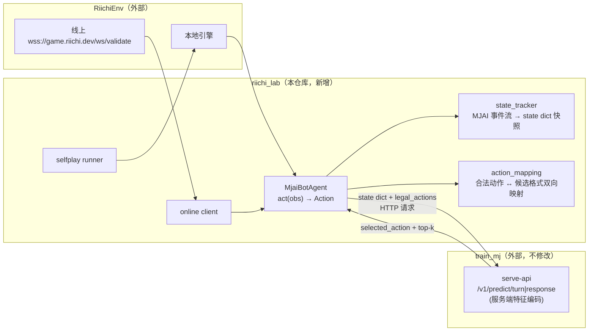
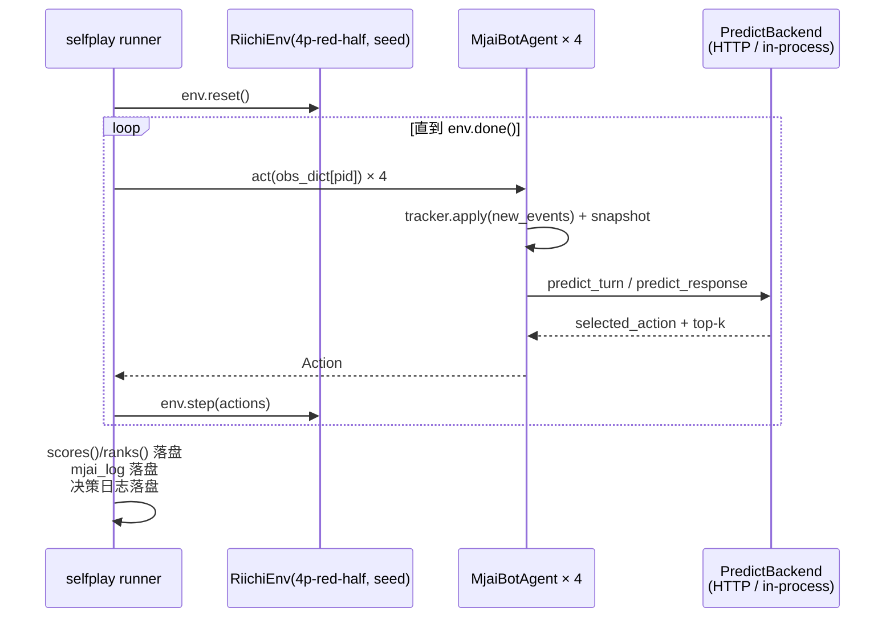
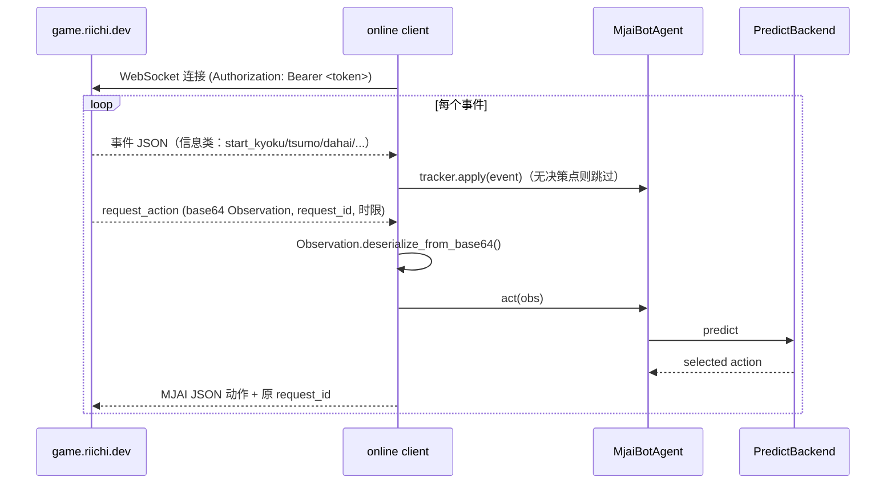

# riichi.dev 接入方案（RiichiLab 自对弈 + 在线对局）

> 状态：方案设计，未开始实现。
> 创建时间：2026-11-02。
> 本仓库（`riichi_lab`）是独立接入项目：把 [riichi.dev](https://riichi.dev)（RiichiLab 开放天梯，底层引擎 [smly/RiichiEnv](https://github.com/smly/RiichiEnv)）与推理项目 `train_mj`（`F:\Code\AI\train_study\train_mj`）对接起来。**不在 `train_mj` 内直接开发对局代码**，避免训练/推理仓库与对局适配层耦合。

## 1. 目标与范围

1. **自对弈回归**：`train_mj` 的模型参数量、特征布局、推理接口会持续迭代；每次迭代后用标准引擎（RiichiEnv）跑固定种子批量对局，检验实战强度，替代/补充基于 Tenhou 牌谱回放的 p800 评估。
2. **在线机器人对局**：接入 riichi.dev 线上对局（`wss://game.riichi.dev/ws/validate`），与线上其他 bot 对战。

不在本方案范围内：

- 三麻（`train_mj` 只支持四麻，只能匹配 4p 房）。
- 和牌/役/计分判断（由 RiichiEnv 引擎负责，模型只做动作选择）。
- 修改 `train_mj` 的训练/特征代码；`train_mj` 只作为被调用方（HTTP API 或版本化依赖）。

## 2. 两侧现状对比

| 维度 | riichi.dev / RiichiEnv | train_mj |
|---|---|---|
| 引擎 | Rust 核心 + PyO3，本地模拟与线上服务器同一引擎，行为完全一致 | 自带规则引擎（`mjai/rules/`），四麻；和牌/役/计分未实现 |
| 机器人接口 | MJAI 协议；本地 `agent.act(obs) -> Action`；在线 WebSocket 交换 MJAI JSON | HTTP API：`POST /v1/predict/turn|response`，输入 `state dict + legal_actions`，服务端完成特征编码 |
| 合法动作 | `obs.legal_actions()` 引擎保证合法；`obs.select_action_from_mjai()` 把 MJAI 回复转回合法 Action | 候选由调用方传入（阶段 3"服务端生成合法候选"未实现） |
| 局面事件 | MJAI 事件流（`start_game/start_kyoku/tsumo/dahai/chi/pon/...`） | 训练侧事件由 Tenhou XML 解析；`state_json` 是特征视角快照，不等价于可回放 GameState |
| 成熟度 | Mortal 兼容，已验证 100 万+ 半庄无错 | serving 阶段 1/2（推理内核 + HTTP API）已完成；阶段 3/4（外部局面接入、在线 session）未开始——由本仓库补齐 |

**结论：两个目标均可行。** RiichiEnv 提供引擎、合法动作与事件流；train_mj 提供推理服务。缺口集中在本仓库要实现的双向适配层：MJAI 事件流 → train_mj state dict，以及动作的双向映射。

## 3. 仓库边界与依赖策略



**核心解耦原则**：`train_mj` 的 HTTP API 是唯一稳定契约（[full-state-api.md] 契约由对方仓库维护）。模型参数量、特征布局、checkpoint 更新只需对方重启 `serve-api`，本仓库不改代码；接口不兼容时由契约测试（§4.6）立即暴露。

与 `train_mj` 的两种集成模式：

| 模式 | 方式 | 适用 | 权衡 |
|---|---|---|---|
| **API 模式（默认）** | 调用 `train_mj` 已运行的 `serve-api` HTTP 服务；特征编码在对方服务端完成 | 在线对局、常规自对弈 | 解耦最彻底；单请求多一次 HTTP 往返（本地毫秒级，可接受） |
| **库模式（可选）** | `train_mj` 以 `pip install -e` 版本化依赖引入，in-process 调 `MahjongPredictor` | 大批量自对弈提速、需要 top-k 深度诊断 | 引入包级依赖，须锁定对方仓库 commit |

无论哪种模式，**本仓库不复制粘贴对方的规则/特征代码**；state_tracker 中确需复用对方规则语义（振听判定等）的部分，在库模式下直接 import `mjai.rules`，API 模式下按 §4.6 契约测试保证口径一致。

## 4. 功能模块设计

### 4.1 模块 A：`rilab/tracker/state_tracker.py` —— 局面翻译层（核心，最大工作量）

**职责**：消费 MJAI 事件流，增量维护局面状态，在决策点导出与 `train_mj` 训练分布完全一致的 state dict 快照（schema 契约 = 对方仓库 `docs/full-state-api.md` / `model-inputs.md`）。

**为什么不能用 `obs.to_dict()` 直接喂**：full_state_v2 特征依赖大量 `train_mj` 自有语义——三类振听（自家舍牌/临时/立直后）判定、`remaining_draws_estimate` 计数口径（初始 70，普通摸牌与岭上摸牌各减一，宣杠不重复减）、弃牌 token 的摸切标志、公开事件序列（reach1/reach2/chi/pon/daiminkan/ankan/kakan/dora）、巡目与自家实际摸牌次数等。

**事件映射表**（MJAI → 内部局面状态）：

| MJAI 事件 | 状态更新 | 注意点 |
|---|---|---|
| `start_game` | 初始化赛制、座位 | 记录自家绝对座位 |
| `start_kyoku` | 局初始化：庄家、点数、本场、立直棒、宝牌指示牌、起手手牌 | `dora_marker → dora_indicators` |
| `tsumo` | 手牌 +1、`turn_number`、`remaining_draws_estimate` 递减、自家实际摸牌次数 +1 | mjai 的 `pai` 含赤牌精确信息（如 `5mr`），转 `0m/0p/0s`；用于摸切判定 |
| `dahai` | 弃牌 token（exact tile + 摸切 + 立直宣言牌标记）、`last_discard_*` | mjai 自带 `tsumogiri` 字段；特征口径"历史不移除被鸣走的弃牌" |
| `reach` | `riichi_declared_by_player[actor]`、public event `reach1`；宣言弃牌后 `reach2` | turn 快照截取须在自家 `reach1` 之前（防标签泄漏） |
| `chi` / `pon` / `daiminkan` | 副露槽更新、public event、来源座位 | `consumed` 保持赤牌精确表示 |
| `ankan` / `kakan` | 副露槽更新（加杠保留原碰来源） | 暗杠 consumed 含四张 |
| `dora` | `dora_indicators` 追加 | — |
| `hora` / `ryukyoku` | 终局结算、振听状态清理 | 点数变动由下一局 `start_kyoku` 覆盖，无需内部复算 |

**关键规则**：

- 快照字段与对方 `full-state-api.md` 冻结 schema 完全一致：`hand / all_discards / all_melds / dora_indicators / scores / riichi_declared_by_player / riichi_turn_by_player / discard_history / public_events / temporary_furiten / riichi_furiten / remaining_draws_estimate / turn_number / honba / riichi_sticks / round_wind / seat_wind / response_target ...`。
- 座位旋转不在 tracker 做：对方编码器在服务端统一旋转为相对座位（0=自家…3=上家），风位不旋转。
- 内部断言（手牌数量、副露消耗牌存在性）失败立即报错终止，不允许静默降级——对局数据一旦污染会误导回归结论。

### 4.2 模块 B：`rilab/mapping/action_mapping.py` —— 动作双向映射

**职责**：RiichiEnv 合法动作 ↔ `train_mj` 候选格式转换；模型输出 → MJAI 回复。

**合法动作来源策略**：**统一使用 RiichiEnv 的 `obs.legal_actions()`**，不用 `train_mj` 的 `rules/legal_actions.py` 重新生成——避免两套规则引擎细微分歧导致选出的动作在该引擎下不合法。最终经 `obs.select_action_from_mjai()` 兜底，保证回给引擎的动作一定合法。

**候选映射（引擎 → 模型）**：

| RiichiEnv/MJAI 动作 | train_mj 候选 kind | 备注 |
|---|---|---|
| `dahai` | `discard {tile}` | 赤牌 `5mr → 0m` |
| `reach` + `dahai` | `riichi_discard {tile}` | 合并为单候选 |
| `hora`（自摸） | `tsumo` | turn 决策点 |
| `ankan` | `ankan {tile}` | — |
| `kakan` | `kakan {tile}` | — |
| 九种九牌流局声明 | `kyuushu_kyuuhai` | — |
| `chi` | `chi {tile, consumed_tiles, source}` | 只允许上家 |
| `pon` | `pon {...}` | — |
| `daiminkan` | `daiminkan {...}` | — |
| `hora`（荣和） | `ron` | response 决策点 |
| 抢杠和 | `chankan` | kakan 响应窗口 |
| `none`/跳过 | `pass` | response 决策点 |

**回复映射（模型 → MJAI）**：`discard → {"type":"dahai","pai":...,"tsumogiri":...}`；`riichi_discard → reach 事件 + dahai`；`tsumo/ron → hora`；`kyuushu_kyuuhai` 按引擎支持的流局声明格式（实现时以 `select_action_from_mjai` 接受的格式为准）。

**推理口径**：response 决策沿用对方已校准 operating point（当前 `pass_bias=1.5 / no_yaku_call_penalty=0`），通过 API 请求参数传递，口径由对方仓库维护。

### 4.3 模块 C：`rilab/agent.py` —— 推理适配 Agent

**职责**：实现 RiichiEnv agent 接口（`act(obs) -> Action`），串联 tracker + mapping + 推理后端，同时服务自对弈与在线对局。

```python
class MjaiBotAgent:
    def __init__(self, player_id: int, backend: PredictBackend, *, pass_bias: float | None = None): ...

    def act(self, obs) -> Action:
        for event in obs.new_events():            # 1. 增量喂事件
            self.tracker.apply(event)
        state = self.tracker.snapshot()            # 2. 导出 state dict
        candidates = self.mapper.to_candidates(obs.legal_actions())
        if self.tracker.is_turn_decision():        # 3. turn / response 分流
            result = self.backend.predict_turn(state, candidates)
        else:
            result = self.backend.predict_response(state, candidates, pass_bias=self.pass_bias)
        mjai_reply = self.mapper.to_mjai(result.selected_action)
        return obs.select_action_from_mjai(mjai_reply)  # 4. 引擎合法性兜底
```

`PredictBackend` 是推理后端抽象，两个实现：

- `HttpPredictBackend`：调用 `train_mj` 的 `serve-api`（默认）；
- `InProcessPredictBackend`：库模式直调 `MahjongPredictor`（大批量自对弈提速用）。

### 4.4 模块 D：`rilab/selfplay.py` —— 自对弈运行器

**职责**：批量跑 `RiichiEnv(game_mode="4p-red-half", seed=...)` 固定种子对局，产出统计与日志。



功能要求：

- **对局编排**：N 局 × 固定种子列表；4 个座位轮换（消除座位偏差）。
- **对照组**：支持 A/B 两个推理后端（新 checkpoint vs 上一版，各占 2 席位轮换）同场对战，直接看新版本相对增益，而不是只看绝对顺位。
- **产物落盘**（`outputs/arena/<run_name>/`）：
  - 每局 `mjai_log`（jsonl，可进 RiichiEnv `GameViewer` 回放）；
  - 每个决策点的 `(state snapshot, legal actions, selected action, top-k score)`，供离线复盘错误决策；
  - 汇总统计：平均顺位、和率、放铳率、立直率、副露率、振听率（和牌/计分统计从引擎侧提取，不依赖本项目任何计分能力）。
- **回归判据**：固定种子集合下新旧后端的顺位分布对比；决策日志 diff 用于定位行为突变点。
- **配置**：`configs/arena_selfplay.yaml`（推理后端地址/模式、seeds、局数、对照组席位分配、产物目录）。

### 4.5 模块 E：`rilab/online/` —— 在线对局客户端

**职责**：连接 `wss://game.riichi.dev/ws/validate`，把线上 `request_action` 转成 Agent 调用并回包。



功能要求：

- **request_id 绑定**：回复必须回带原 `request_id`，乱序/迟到请求按协议丢弃。
- **时限管理**：`grace_ms=3000 / bank_ms=15000 / deadline_ms=18000`；客户端设置比 `deadline_ms` 更早的内部软超时（预留 1s 网络与序列化余量），超时兜底回复当前最安全的合法动作（通常是 `pass` / 摸切）。
- **密钥管理**：bot token 走环境变量（如 `RIICHI_DEV_BOT_TOKEN`），禁止写入配置文件与日志。
- **可观测性**：对局事件流、每步决策与耗时落盘，便于赛后复盘与超时归因。
- **配置**：`configs/arena_online.yaml`（endpoint、软超时、推理后端、pass_bias、日志目录）。
- **前置流程**：先在 riichi.dev 注册 bot 并通过其 Bot Validation 校验，再进入正式排位。

### 4.6 模块 F：对拍验收（契约 + parity 测试，正确性闸门）

**职责**：双重验收——(a) 与 `train_mj` 训练管线对拍，证明事件流路径构建的特征与训练分布一致；(b) 契约测试，证明对方 API schema 变更时本仓库立即感知。

```mermaid
graph LR
    XML["train_mj Tenhou XML 夹具<br/>(对方 tests 目录, 只读)"] -->|对方训练管线<br/>sample_builder| S1["state_json / 特征向量"]
    XML -->|XML → MJAI 转换<br/>(本仓库 scripts/)| EV["mjai 事件流"]
    EV -->|rilab tracker| S2["state dict"]
    S2 -->|对方 serve-api| FEAT["服务端编码特征"]
    S1 --> CMP{"逐位对比"}
    FEAT --> CMP
    CMP -->|一致| PASS["通过：可上线"]
    CMP -->|不一致| FAIL["阻断：修复 tracker 或<br/>同步对方契约变更"]
```

- **夹具来源**：只读引用对方 `tests/` 的 Tenhou XML 夹具（路径可配置），转出 MJAI 事件流；另用 RiichiEnv 自对弈 `mjai_log` 作为增量夹具补充边角局面（杠后宝牌、抢杠、九种九牌等）。
- **对比粒度**：state 快照字段 → 对方服务端编码后的输出（含 11969 / 12012 维特征口径的请求/响应一致性）；发现差异立即阻断。
- **契约测试**：对 `/v1/predict/turn|response` 的请求/响应 schema 做版本快照断言；对方升级接口后跑 CI 即报错，倒逼本仓库适配——这正是"模型迭代不破坏接入"的保障。
- **覆盖要求**：turn 与 response 两侧；每类动作候选至少出现一次。

## 5. 本仓库目录结构规划

```text
riichi_lab/
  docs/
    riichi-dev-integration.md   # 本方案
  rilab/                        # Python 包
    __init__.py
    tracker/
      __init__.py
      state_tracker.py          # 模块 A
    mapping/
      __init__.py
      action_mapping.py         # 模块 B
    backends/
      __init__.py
      base.py                   # PredictBackend 抽象
      http_backend.py           # API 模式：调 train_mj serve-api
      inprocess_backend.py      # 库模式：直调 MahjongPredictor
    agent.py                    # 模块 C
    selfplay.py                 # 模块 D
    online/
      __init__.py
      client.py                 # 模块 E：WebSocket 客户端与重连
      session.py                # 模块 E：request_id 绑定、时限管理
    cli.py                      # 入口
  configs/
    arena_selfplay.yaml
    arena_online.yaml
  scripts/
    tenhou_xml_to_mjai.py       # 对拍用一次性转换脚本
  tests/
    fixtures/                   # 转换后的 mjai 事件流夹具
    test_state_tracker.py       # 模块 F 对拍
    test_action_mapping.py
    test_backends_contract.py   # 模块 F 契约测试
    test_agent_smoke.py
  outputs/                      # 对局产物（不进 git）
  pyproject.toml
```

依赖管理：

```toml
[project]
dependencies = [
    "riichienv>=0.1",
    "websockets>=13",
    "httpx>=0.27",
]

[project.optional-dependencies]
inprocess = [
    # 库模式：以可编辑安装指向 train_mj，锁定 commit
    "mjai @ file:///F:/Code/AI/train_study/train_mj",
]
```

CLI 入口：

```bash
rilab arena-selfplay --config configs/arena_selfplay.yaml
rilab arena-online  --config configs/arena_online.yaml
rilab parity-check  --config configs/parity.yaml   # 对拍验收
```

## 6. 落地阶段与验收标准

| 阶段 | 内容 | 验收标准 |
|---|---|---|
| A1 | 模块 B（动作映射）+ 单测 | 全部动作类型双向映射有用例覆盖；赤牌转换正确 |
| A2 | 模块 A（state tracker）+ 模块 F（对拍） | 对方夹具上快照/编码逐位一致；边角局面（杠/抢杠/振听/九种九牌）覆盖 |
| A3 | 模块 C（Agent）+ 模块 D（自对弈 runner） | 固定种子跑通 ≥100 半庄无非法动作、无 tracker 断言失败；产出统计与决策日志 |
| A4 | 模型迭代回归流程 | 新旧 checkpoint 对照对战报告可复现（固定种子 + 席位轮换）；契约测试对对方接口变更敏感 |
| B1 | 模块 E（在线客户端） | 通过 riichi.dev Bot Validation（`ws/validate`） |
| B2 | 线上对局 | 正式排位稳定运行；无超时判负；决策日志完整落盘 |

A 系列先行（目标 1），稳定后推进 B 系列（目标 2）。

## 7. 风险与对策

| 风险 | 影响 | 对策 |
|---|---|---|
| 特征口径不一致（振听判定、remaining_draws 计数、摸切标志等） | 高：线上强度 silently 下降，且难以归因 | 模块 F 对拍作为强制闸门；口径以对方 `model-inputs.md` 为唯一契约，不凭记忆重写规则 |
| 对方特征版本漂移（v2 → v3，state schema 变更） | 高：适配层失效 | 契约测试 + 对拍测试双保险；升级流程 = 对方更新文档 → 本仓库跑 parity → 修复 tracker |
| 两套规则引擎分歧（对方 rules vs RiichiEnv） | 中：生成不合法动作或候选集合不一致 | 统一采用引擎侧 `legal_actions()`；`select_action_from_mjai` 兜底 |
| 线上超时 / 断线 | 中：判负、rating 损失 | 内部软超时 + 安全兜底动作；客户端自动重连 |
| RiichiEnv 协议演进（在线协议/校验流程变化） | 低：客户端适配 | 协议细节收敛在 `rilab/online/`；参考实现（lisbun/lisjong、Mortal 接入方式） |
| 对局数据污染（tracker 静默降级） | 高：回归结论误导 | 断言失败立即终止整批对局；决策日志可回放审计 |

## 8. 与外部仓库的关系

- `train_mj`（只读依赖）：提供 `serve-api` HTTP 服务（推理 + 特征编码）与 `full-state-api.md` / `model-inputs.md` 契约文档；本仓库不修改其代码。
- `riichienv`（PyPI 依赖）：提供本地引擎、Observation、合法动作与 MJAI 协议；线上对局同一引擎。
- 本方案落地后，`train_mj` 的 serving 阶段 3/4 缺口由本仓库在外部补齐，无需回写对方仓库文档；对方仓库只需保持 API 契约稳定。
